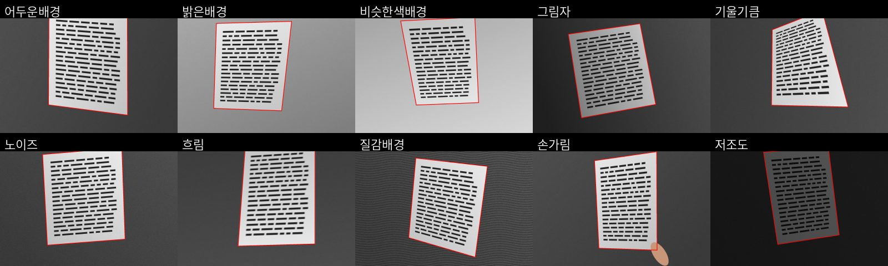
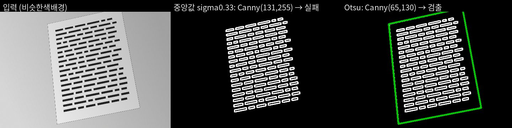

# [edge] 블러 종류 · Canny 임계값 · 모폴로지 비교

- 담당 / 날짜: 한시원 / 11.25
- 질문: 어떤 블러 · Canny 임계값 방식 · 모폴로지 조합이 검출 성공률이 가장 높고, 실시간(라이브 루프)에 부담이 없는가
- 방법: `python experiments/edge_params.py --synthetic` (처리 해상도 480px)
  - 데이터: 조건별 합성 사진 60장 (`scanner/synthetic.py` 의 `make_condition_set`, 10개 조건 × 6장, 1920×1440). 실제 사진(data/raw)이 아직 저장소에 없어 합성 세트로 먼저 비교했다
  - 성공 기준: 꼭짓점 평균 오차 ≤ 문서 대각선의 2% (`evaluate.py` 와 같은 기준)
  - 조합: 블러 5종 × 임계값 5종 × 모폴로지 5종 = 125가지, 시간은 블러~검출까지 이미지당 중앙값(PC)

## 결과

### 요소별 최고 성공률 (나머지 두 요소는 가장 좋은 값으로 고정)

| 블러 | 최고 성공률 | 시간(ms) |
|---|---|---|
| gaussian5 (현재) | 53/60 | 0.61 |
| gaussian7 | 48/60 | 0.73 |
| median5 | 54/60 | 0.71 |
| median7 | 53/60 | 6.07 |
| bilateral | 48/60 | 2.58 |

| Canny 임계값 | 최고 성공률 |
|---|---|
| 중앙값 sigma 0.2 / 0.33(현재) / 0.5 / 0.7 | 48/60 (네 값 모두 같음) |
| **Otsu (upper = Otsu 값, lower = upper × 0.5)** | **54/60** |

| 모폴로지 | 최고 성공률 |
|---|---|
| none | 53/60 |
| close3 / dilate3 / close3+dilate3(현재) / close5+dilate3 | 54/60 |

### 조건별 (gaussian5 + close3+dilate3 고정)

| 조건 | 중앙값 sigma0.33 (이전 기본) | Otsu (변경) |
|---|---|---|
| 어두운배경 · 밝은배경 · 그림자 · 기울기큼 · 노이즈 · 흐림 · 저조도 | 각 6/6 | 각 6/6 |
| 비슷한색배경 | **0/6** | **5/6** |
| 질감배경 | 5/6 | 6/6 |
| 손가림 | 0/6 | 0/6 |
| 합계 | 47/60 | 53/60 |

- Otsu 의 lower 비율: 0.33 → 53/60, 0.5 → 53/60, 0.66 → 49/60
- 문서가 없는 장면 30장(균일·질감 배경, 흐릿한 얼룩)에서 잘못 검출한 경우: 중앙값·Otsu 모두 0/30

## 해석

- 중앙값 방식은 밝은 화면에서 임계값이 같이 올라간다. 흰 책상(밝기 약 215) 위의 흰 문서(245)는 경계의 밝기 차이가 30 정도라 Canny(131, 255) 로는 잡히지 않는다. sigma 를 바꿔도 lower 만 낮아지고 upper 가 255 근처에 머물러서 효과가 없었다.
- Otsu 값은 '문서와 배경을 가르는 밝기'라서 화면 전체 밝기와 상관없이 문서 경계 대비에 맞춰진다 (위 예시 Canny(65, 130)).
- median5 는 비슷한색배경에서 1장 더 잡았지만 차이가 1/60 이라 실제 사진으로 다시 확인한다. median7 은 OpenCV 구현상 커널 7부터 느려져(6ms) 라이브 루프에 맞지 않는다. bilateral 은 느리고(2.6ms) 성공률도 낮았다.
- 모폴로지는 none 만 1장 적고 나머지는 차이가 없어서 현재 방식(close3 + dilate3)을 유지한다.
- 손가림은 모서리가 가려져 4각형 근사가 안 되는 경우로, 엣지 단계가 아니라 detect 대안 단계(신승준 PR #1, convexHull/minAreaRect)에서 해결할 문제다.

## 결론

- **Canny 임계값을 Otsu 기반으로 변경** (Python `OTSU_LOW_RATIO = 0.5`, `CANNY_MIN_UPPER = 30` ↔ Dart `kOtsuLowRatio`, `kCannyMinUpper`). 화면이 거의 균일해 Otsu 값이 0 근처가 될 때 잡음이 엣지가 되지 않도록 upper 하한 30 을 둔다.
- 블러(gaussian5), 모폴로지(close3 + dilate3)는 유지. median5 는 실제 사진 비교 후 결정.
- 브랜치 `feat/edge-otsu-canny`
- 남은 일: data/raw 실제 사진 40장이 모이면 `python experiments/edge_params.py` (합성 옵션 없이) 로 같은 표를 다시 만들어 확정한다.
